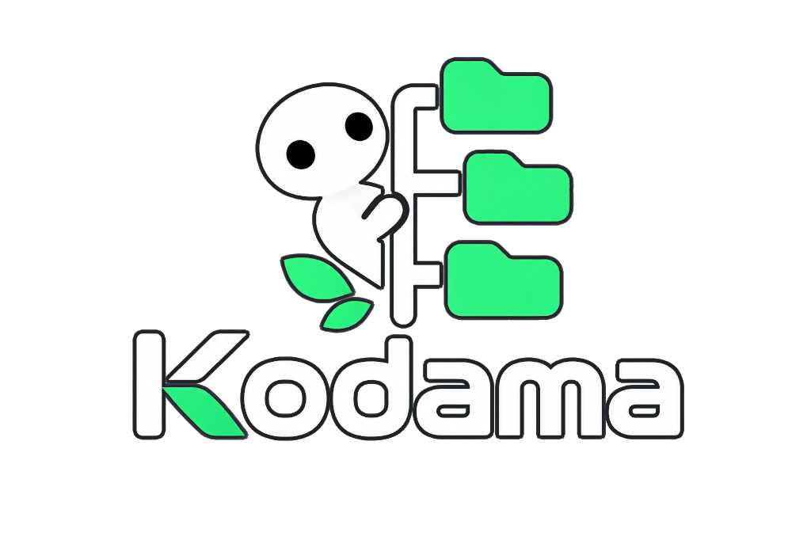

<p align="center">
  <picture>
    <source media="(prefers-color-scheme: dark)" srcset="assets/kodama-logo.png">
    
  </picture>
</p>

# Kodama

Rust でゼロから書いた GPU (wgpu) 描画のターミナルエミュレータです。
ペイン分割・タブ・ファイルツリーを内蔵し、設定は Lua で書けます。

## 主な機能

- **描画**: wgpu によるインスタンス描画、リガチャ、カラー絵文字（ZWJ・肌色・国旗も 1 セルに）、
  フォントフォールバック、罫線・ブロック文字の自前描画、背景透過
- **画面管理**: Hyprland 風のペイン分割（dwindle）、ペインの移動・リサイズ・ズーム、タブ。
  終了時のレイアウトと、各ペインに出ていたコマンドと出力を次の起動で戻す。
- **操作**: スクロールバック検索、コピーモード（vi キー）、クイックセレクト（URL・パス・ハッシュをラベルで選択）、
  コマンドパレット、ファイルツリー（git 状態表示・ファイル操作）
- **端末機能**: xterm 互換、truecolor、kitty キーボードプロトコル、kitty 画像プロトコル、
  OSC 7（作業ディレクトリ）/ 8（ハイパーリンク）/ 52（クリップボード）/ 133（プロンプト位置）
- **設定**: Lua 5.4 の `config.lua`・`theme.lua`・`keybind.lua`。保存すると即時反映、
  48 種のカラースキームを内蔵

## インストール

[Releases](https://github.com/k-noguchi0502/kodama/releases/latest) から入手できます（x86_64 Linux）。

### Arch Linux（pacman）

`/etc/pacman.conf` の末尾に追加します。

```ini
[kodama]
SigLevel = Optional TrustAll
Server = https://github.com/k-noguchi0502/kodama/releases/latest/download
```

```bash
sudo pacman -Sy
sudo pacman -S kodama
```

このチェックアウトからパッケージを作って入れる場合は `cd packaging && makepkg -si` です。

### Debian / Ubuntu

```bash
sudo apt install ./kodama_*_amd64.deb
```

### アーカイブ

```bash
# ~/.local にバイナリ・デスクトップエントリ・アイコンを入れる
tar xzf kodama-v*-x86_64-linux.tar.gz
cd kodama-v*-x86_64-linux && ./install.sh   # 削除は ./install.sh --uninstall
```

`Cargo.toml` の `version` を上げて master に push すると、
GitHub Actions がビルドして新しいリリース（pacman 用パッケージ、deb、アーカイブ）を作ります。

## ビルドと起動

必要なもの: Linux、Rust (edition 2024)、wgpu が使える GPU ドライバ（Vulkan など）、
fontconfig（`fc-match`）。クリップボードは Wayland 向けです。

```bash
cargo build --release
./target/release/kodama            # 設定したシェルを起動
./target/release/kodama -e htop    # シェルの代わりにコマンドを実行
```

```text
kodama [OPTIONS] [-e COMMAND [ARGS...]]

  -c, --config <FILE>      設定ファイル（既定: ~/.config/kodama/config.lua）
  -f, --font <FAMILY>      フォント（fontconfig パターン）
  -s, --size <POINTS>      フォントサイズ（pt）
      --no-ligatures       リガチャを無効化
      --scrollback <LINES> スクロールバック行数
  -e, --command <CMD>...   シェルの代わりに CMD を実行
  -V, --version            バージョンを表示して終了
  環境変数 KODAMA_CONFIG でも設定ファイルを指定できます
```

アプリランチャーにアイコン付きで出すには、バイナリ・デスクトップエントリ・アイコンを入れます。

```bash
install -Dm755 target/release/kodama ~/.local/bin/kodama
install -Dm644 assets/kodama.desktop ~/.local/share/applications/kodama.desktop
install -Dm644 assets/kodama.png ~/.local/share/icons/hicolor/512x512/apps/kodama.png
```

旧名 trex で使っていた `~/.config/trex/` は、`~/.config/kodama/` が無い間はそのまま読み込みます。
設定内の `trex.send(...)` なども引き続き動きます。

## 設定

設定はすべて任意です。`examples/` をコピーして編集してください。

```bash
mkdir -p ~/.config/kodama
cp examples/config.lua examples/theme.lua examples/keybind.lua ~/.config/kodama/
```

| ファイル | 内容 |
|---|---|
| `config.lua` | フォント、ウィンドウ、ペイン間隔、シェル、スクロールバックなど |
| `theme.lua` | カラースキームの選択、色の上書き、自作スキーム |
| `keybind.lua` | キーバインド（文字列のアクション・送信テキスト・Lua 関数） |
| `shell-integration.zsh` / `.bash` | プロンプト間ジャンプと作業ディレクトリ通知 |

どれも保存すると自動で読み直されます（`alt+shift+r` でも再読み込み）。
エラーはターミナル内に表示されます。

## 操作方法

既定のキー操作とマウス操作は [docs/usage.md](docs/usage.md) にまとめています。
よく使うものだけ抜き出すと次のとおりです。

| キー | 動作 |
|---|---|
| `alt+shift+p` | コマンドパレット |
| `alt+enter` / `alt+q` | ペインを開く / 閉じる |
| `alt+矢印` | ペイン間を移動 |
| `alt+shift+t` | 新しいタブ |
| `alt+shift+f` | 検索 |
| `alt+shift+x` | コピーモード |
| `alt+shift+space` | クイックセレクト |
| `alt+shift+b` | ファイルツリー |

## ソースの構成

```text
src/
├── main.rs          エントリポイント
├── app.rs           ウィンドウとイベントループ、ペイン・タブ・各モードの統括
├── layout.rs        ペイン配置（分割の二分木）と Rect
├── pty.rs           擬似端末の生成とシェルの起動
├── config/          設定
│   ├── mod.rs       設定の型、既定値、アクションと既定キー、コマンドライン
│   ├── lua.rs       Lua 実行環境（config / theme / keybind の読み込み）
│   ├── schemes.rs   内蔵カラースキーム
│   └── watch.rs     設定ディレクトリの監視（inotify）
├── terminal/        端末エミュレーション
│   ├── mod.rs       画面・カーソル・モード・スクロールバック
│   ├── parser.rs    エスケープシーケンスのパーサ
│   ├── input.rs     キー入力 → アプリへ送るバイト列
│   ├── cluster.rs   書記素クラスタ（絵文字の結合）
│   └── graphics.rs  kitty 画像プロトコル
├── renderer/        描画
│   ├── mod.rs       wgpu レンダラ
│   ├── font.rs      フォント読み込み・シェーピング・フォールバック
│   ├── boxdraw.rs   罫線・ブロック文字
│   └── shader.wgsl
└── ui/              ペイン上に重ねる対話的な画面
    ├── copymode.rs
    ├── palette.rs
    ├── quickselect.rs
    └── tree.rs
```

## 開発

```bash
cargo fmt
cargo clippy --release --all-targets   # 警告ゼロを維持
cargo test --release
```

## ライセンス

MIT
